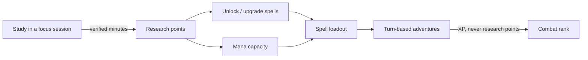
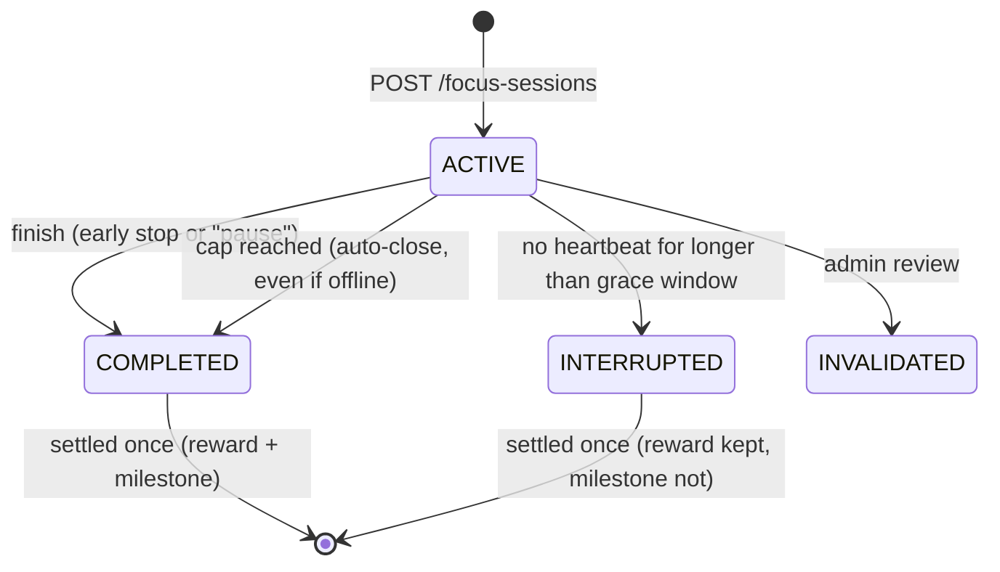

# Wizard Study RPG — MVP

A fantasy role-playing productivity app that turns **real focus time** into research points, spells and turn-based adventures. You study away from the game. When you come back, your wizard has grown.

This repository is the **MVP (Phase 1 / P0)** of the *Wizard Study RPG* product and engineering specifications. It is a working full-stack app with a server-authoritative focus timer, an exactly-once reward ledger, a research tree for three elements, and deterministic turn-based PvE. All ten acceptance scenarios (AT-01 to AT-10) are covered: nine by automated tests, and AT-09 (keyboard-only use) is a manual check (see [Testing](#testing)).

> **Product honesty (FOC-07):** the timer records *declared* focus time. It does not and cannot prove that anyone studied or learned anything. The app never claims otherwise, and never uses webcam, microphone or screen monitoring.

---

## Contents

1. [Quick start](#quick-start)
2. [What is in the MVP](#what-is-in-the-mvp)
3. [How the game works](#how-the-game-works)
   - [Focus sessions and breaks](#focus-sessions-and-breaks)
   - [Rewards](#rewards)
   - [Research and spells](#research-and-spells)
   - [Combat](#combat)
4. [Architecture](#architecture)
5. [Data model](#data-model)
6. [API reference](#api-reference)
7. [Configuration](#configuration)
8. [Security, privacy and fairness](#security-privacy-and-fairness)
9. [Accessibility](#accessibility)
10. [Testing](#testing)
11. [Requirements traceability](#requirements-traceability)
12. [Decisions and interpretations](#decisions-and-interpretations)
13. [Known limitations and next steps](#known-limitations-and-next-steps)

---

## Quick start

**Prerequisites:** Node.js **22.13 or newer** (uses the built-in `node:sqlite`, so there is no database to install).

```bash
npm install          # installs both workspaces (server + client)
npm run dev          # API on http://localhost:3001, web app on http://localhost:5173
```

Open **http://localhost:5173**, create an account, pick an element, and start your first guided 25-minute session.

| Task | Command |
|---|---|
| Run API + web app with hot reload | `npm run dev` |
| Run the test suite (68 tests) | `npm test` |
| Typecheck both workspaces | `npm run typecheck` |
| Production build | `npm run build` |
| Run production server (serves the built client too) | `npm start` → http://localhost:3001 |
| Make an account an administrator | `npm run promote-admin -w server -- you@example.com` |

**No email provider in the MVP.** In development, password-reset and email-verification links are written to the API log as `dev_email_link` lines. Open them in the browser (prefix with `http://localhost:5173`).

The SQLite database lives at `server/data/wizard-study.db` by default. Delete the file to start fresh. Environment variables are listed in [Configuration](#configuration). To set them, copy [`.env.example`](.env.example) to `server/.env`; the server reads it on start.

---

## What is in the MVP

| Area | Delivered | Spec refs |
|---|---|---|
| Accounts | Email/password sign-up and sign-in, rotating refresh sessions, sign out of one or all devices, password reset, email verification, consent records, data export, account deletion | AUTH-001…006, ACC-01…03 |
| Onboarding | Learning goal → wizard name → starter element → guided first session | ACC-02, journey "First-time learner" |
| Focus timer | Server-authoritative timer, heartbeats with a reconnect grace window, 90-minute cap with auto-close, 20-minute break, fatigue rule, early finish, interruption recovery, live reward estimate, final breakdown | FOC-01…07, FOCUS-001…008 |
| Reward ledger | Append-only, idempotent, non-negative balances, daily soft cap, versioned rules on every award | ECON-001…006 |
| Research | Spell tree for Fire, Lightning and Light (3 tiers each), incremental research, 60-minute milestones, critical levels 5 and 10, mana capacity track | RES-01…06, MAGIC-001…007 |
| Combat | Deterministic, seeded, server-authoritative turn-based PvE; element matrix and status effects as data; six encounters including a tutorial and a boss; capped XP; separate combat rank | MAG-01…04, COMBAT-001…007 |
| Dashboards | Home dashboard, weekly trend, gentle streaks, optional daily goal, full session and ledger history | FOC-06, `/history` |
| Settings | Timezone, goals, notification toggles and quiet hours, privacy, accessibility (reduced motion, high contrast, larger text) | ACC-03, NFR-005 |
| Admin (API only) | Publish versioned rulesets (validated against safety rules), ledger reconciliation, invalidate abusive sessions with reversal, audit log | ADM-01, ADM-03, ECON-006 |
| Notifications | Browser notifications for break end and session complete, respecting quiet hours. Optional ambient focus sound (founder note in §4) | MVP "basic notifications" |

**Deliberately not in the MVP** (Phase 2+ per the spec): study rooms and friends, Water/Earth/Dark as playable elements, PvP and ranked rating, co-op, islands and buildings, equipment, cosmetics shop and payments, guilds, public spaces, admin web UI, anomaly detection (FOCUS-009).

---

## How the game works



Studying is the **only** source of research points. Combat tests the loadout you built and awards experience only, so playing never substitutes for studying.

### Focus sessions and breaks



| Rule | Behaviour (default ruleset) |
|---|---|
| One session at a time | A second start from any device returns `409 SESSION_ALREADY_ACTIVE`. A partial unique index enforces it in the database too. |
| Server time only | Start, end and elapsed time come from server timestamps. The client clock is display-only and is re-synced on every heartbeat. |
| Heartbeats | The client pings every **30 s**. Silences of up to **5 min** (tab in background, network blip) are fully credited when the client comes back. |
| Disconnects | If nothing arrives for longer than the grace window, the session becomes **INTERRUPTED** at the *last verified heartbeat*. The unverified gap is not credited, but every minute before it is (*no loss of earned progress*). |
| 90-minute cap | Credited continuous focus is capped at **90 min**. The session auto-completes exactly at the cap, whether or not the client is connected. |
| Required break | After reaching the cap, a **20-minute** break must pass before another rewarded session can start (`422 BREAK_REQUIRED`). |
| Fatigue rule | Sessions separated by less than 20 minutes count as one continuous block, so two 60-minute sessions with a 5-minute gap cannot dodge the break. The second session's cap is shortened to the remaining budget, and the UI says so. |
| Pause | MVP policy: pausing **ends** the session (FOCUS-003). Nothing earned is lost. |
| Idempotent state changes | Finishing an already-closed session returns its original result. |

Correctness never depends on a timer firing. Every focus request first *reconciles* the account (closing sessions whose cap or grace window has passed). A background worker (every 15 s) does the same for learners who never come back.

### Rewards

Formula from the engineering spec §6. Every parameter lives in a versioned ruleset, and each award stores the ruleset id it was calculated under.

```
eligible_minutes = min(90, validated_minutes)
credited_minutes = min(eligible_minutes, 240 - minutes already credited today)
multiplier       = 1.00 (0-29 min) | 1.10 (30-59 min) | 1.20 (60-90 min)
awarded_points   = floor(credited_minutes × 1 pt/min × multiplier × room_bonus)
```

| Session | Points | Notes |
|---|---|---|
| 25 min | 25 | Enough to unlock your starter spell |
| 35 min | 38 | BR-02 example: floor(35 × 1.10) |
| 60 min | 72 | Also qualifies for a research milestone |
| 90 min (cap) | 108 | Followed by a 20-minute break |
| 60 min with 220 min already credited today | 24 | 20 credited minutes × 1.20. The breakdown shows a 40-minute "over daily cap" deduction |

- Multipliers are integer basis points (`12000` = 1.20×), so award arithmetic never has floating-point drift.
- The multiplier follows *session length* (rewarding focus), while the daily cap limits *credited minutes* (protecting wellbeing).
- Time beyond the daily cap is still logged in history; it just earns nothing.
- The study day follows the learner's timezone (set at sign-up, editable in Settings).
- The room bonus is fixed at 1.00× until study rooms ship. Schema validation caps it at 1.05×.

### Research and spells

Each element has a three-tier tree. Arcane Bolt and Guard are baseline actions every wizard knows (MAG-02).

| Element | Tier 1 | Tier 2 (needs T1 lv 2) | Tier 3 (needs T2 lv 3) |
|---|---|---|---|
| 🔥 Fire (damage over time) | Ember Lance: damage, 60% burn | Fireball: damage, guaranteed burn | Inferno: heavy damage, strong burn |
| ⚡ Lightning (disruption) | Static Spark: damage, 30% paralysis | Chain Lightning | Tempest Call: 50% paralysis |
| ✨ Light (support) | Mending Light: heal | Radiant Aegis: shield | Solar Smite: damage + heal |

**Research states** (MAGIC-001): `LOCKED → AVAILABLE → IN_PROGRESS → MILESTONE_PENDING → UNLOCKED → MAXED`

- **Incremental funding:** put any number of points toward the next level. Over-allocation is clamped to the remaining cost.
- **Atomic:** the debit, progress update and any resulting level-up commit together or not at all (BR-04). Requests include `expected_level`, so a stale second tab gets `409` instead of double-spending.
- **Costs:** unlock T1 = 25, T2 = 120, T3 = 300 RP. Upgrades start at 30/60/120 RP and grow ×1.35 per level. Spells go up to level 10, and each level adds +12% power.
- **Milestones** (MAGIC-002/003, RES-03/04): the *initial unlock* of a spell and *critical levels 5 and 10* also need one **uninterrupted 60-minute session**. You can pick the spell when starting a session, or apply a qualifying session afterwards (`POST /v1/research/milestones`). A session can satisfy only one milestone. Interrupted or short attempts never remove points, and the session's normal reward is always granted.
- **Starter exemption:** your starter element's tier-1 spell has no milestone, so the first-time journey works: 25-minute session → unlock first spell → tutorial battle (see [Decisions](#decisions-and-interpretations)).
- **Mana capacity** (MAGIC-006) is a separate upgrade track: 40 mana at level 1, +10 per level, cost 40 × 1.5^(level−1).
- **Loadout** (MAGIC-007): 4 slots, validated server-side (must be unlocked, no duplicates, no baseline spells), with optimistic `revision` checks. Newly unlocked spells auto-equip into a free slot.

### Combat

Recommended MVP model from the spec: **server-authoritative, deterministic, seeded, turn-based PvE.**

- **Turn:** the player picks one action. The enemy AI picks by weighted random. The faster combatant acts first (the player wins ties, and Guard always resolves first). Then end-of-round effects apply: burn ticks, durations, cooldowns, +6 mana regen.
- **Server-authoritative:** the client only sends `{turn_version, spell_id}`. Outcomes and rewards are computed and settled on the server, and request schemas are strict, so a forged `"result": "victory"` is a `400` (AT-06).
- **Stale or duplicate actions:** `turn_version` must match the current turn. Replays get `409 STALE_TURN` with no effect (AT-07).
- **Determinism:** the PRNG is seeded from the match's private seed and the turn number. `replay(snapshot, seed, actions)` reproduces any battle exactly, which supports audits and is covered by tests.
- **Immutable snapshot** (COMBAT-001): stats, spell levels and enemy definitions are frozen when the match starts.
- **Exactly-once settlement** (COMBAT-006): `IN_PROGRESS → SETTLING → FINISHED`. The XP credit and the transition commit together under ledger key `combat-reward:<match>`. A worker finishes anything left in `SETTLING` after a crash (AT-10).
- **Rewards:** XP only, capped at 600 per study day. Defeat or forfeit costs nothing. Idle battles are auto-surrendered after 24 h.
- **Combat rank** comes from XP and is independent of study progress (MAGIC-008, RAN-01).

**Element matrix** (attacker → defender; anything not listed is 1.0×). Stored as data in `server/src/content/elements.ts` (COMBAT-004):

| Attacker \ Defender | Fire | Lightning | Light | Water | Earth | Dark |
|---|---|---|---|---|---|---|
| **Fire** | 0.75 | | | 0.5 | **1.5** | |
| **Lightning** | | 0.75 | | **1.5** | 0.5 | |
| **Light** | | | 0.75 | | | **1.5** |
| Water (enemy) | **1.5** | | | 0.75 | | |
| Earth (enemy) | 0.75 | **1.5** | | | | |
| Dark (enemy) | | | **1.5** | | | 0.75 |

**Status rules** (COMBAT-005): *Burn* does not stack. Re-applying it refreshes the duration and keeps the stronger tick, and it bypasses guard. *Paralysis* gives a 50% chance to lose each affected turn and grants 1 turn of immunity when it ends. *Shield* absorbs damage, and a new shield replaces the old one only if stronger. *Guard* halves incoming damage for the round and restores mana.

**Encounters:** Training Golem (tutorial) · Ember Imp · Storm Wisp · Tidal Serpent · Shade Wraith · The Hollow Archivist (boss).

---

## Architecture

A **modular monolith** (spec §9/§14): one deployable TypeScript service with clear module boundaries, plus a React single-page app. In production the API serves the built client from the same origin.

```
wizard-study-rpg/
├── package.json                 npm workspaces: server + client
├── server/                      Express 5 + TypeScript + node:sqlite
│   ├── src/
│   │   ├── index.ts             entry: env → db → context → app → worker
│   │   ├── app.ts               middleware chain + module routers
│   │   ├── context.ts           AppContext {db, clock, log, env, rules}, passed explicitly
│   │   ├── worker.ts            background reconciliation and settlement
│   │   ├── config/              env.ts, ruleset.ts (schema + safety invariants), rulesetStore.ts
│   │   ├── content/             elements + matrix, spells, encounters (data, versioned)
│   │   ├── db/                  migrations.ts (schema), database.ts (transactions, helpers)
│   │   ├── http/middleware.ts   request id, logging, auth, rate limit, Idempotency-Key, errors
│   │   ├── lib/                 clock (injectable), crypto, time (study days), errors, logger
│   │   └── modules/
│   │       ├── identity/        auth, sessions, preferences, export, deletion
│   │       ├── wizard/          profile, stats, loadout
│   │       ├── focus/           session lifecycle, reconciliation, rewards.ts (pure formula)
│   │       ├── ledger/          the only code that changes balances
│   │       ├── research/        tree, allocation, milestones, mana
│   │       ├── combat/          engine.ts (pure, deterministic) + service.ts (persistence)
│   │       ├── history/         ledger listing
│   │       ├── analytics/       opt-in pseudonymous events, audit log
│   │       └── admin/           rulesets, reconciliation, invalidation, audit
│   └── test/                    Vitest + Supertest acceptance tests
└── client/                      React 19 + Vite + React Router
    └── src/
        ├── api/                 fetch client (token refresh, idempotency keys) + response types
        ├── auth/                AuthContext (session restore, login/register/logout)
        ├── components/          Layout (nav, skip link), UI primitives
        ├── lib/                 formatting, notifications, ambient sound, useLoad hook
        └── pages/               Welcome, Onboarding, Dashboard, Focus, Research, Wizard,
                                 Adventure (+ Battle), History, Settings, auth links
```

**Key design decisions**

- **Server-authoritative everything.** The client never calculates authoritative rewards, timer results or combat outcomes. It shows estimates and renders server state.
- **Exactly-once money.** All balance changes go through `ledger/service.ts#postEntry`, which writes an append-only ledger row and the balance projection in one transaction. Each credit has a globally unique `idempotency_key` (e.g. `focus-reward:<session>`), and `balances.amount` has `CHECK (amount >= 0)`. Reward and currency endpoints *also* require an `Idempotency-Key` header, so retried HTTP requests replay the stored response.
- **Testable time.** All rules read time from an injected `Clock`. Tests use `FakeClock` to fast-forward through 90-minute sessions in milliseconds.
- **Pure cores.** `focus/rewards.ts` and `combat/engine.ts` have no I/O, which makes them easy to unit-test and swap. The combat engine can be replaced by an auto-battle or real-time mode without touching progression (spec §9).
- **Data-driven content and rules.** Spells, enemies, the element matrix and every economy number live in data. Rulesets are immutable once published and validated against safety invariants.
- **SQLite now, PostgreSQL-ready.** For a zero-setup MVP the app uses Node's built-in SQLite (WAL mode). The schema avoids SQLite-only features (ISO-8601 UTC text timestamps, UUID text keys, partial unique indexes, CHECK constraints), so it ports to PostgreSQL directly. `node:sqlite` is synchronous, so each request's transaction runs without interleaving. That is a simple and correct model for one API instance. See [next steps](#known-limitations-and-next-steps) for scaling out.

**Request pipeline:** `helmet → JSON (32 kb limit) → cookies → request id + structured log → rate limit → bearer auth → module router → [Idempotency-Key] → handler → error formatter`.

---

## Data model

Defined in [`server/src/db/migrations.ts`](server/src/db/migrations.ts).

| Table | Purpose and key constraints |
|---|---|
| `accounts` | Identity and private preferences (JSON). `email` unique (case-insensitive), nulled on deletion. `role` player/admin. |
| `consents` | Append-only record of terms, privacy and analytics consent with version. |
| `auth_sessions` | One row per device login. Only SHA-256 hashes of access and refresh tokens. `family_id` links rotations for reuse detection. |
| `auth_tokens` | Single-use, expiring password-reset and email-verify tokens (hashed). |
| `wizards` | Public profile, one per account (`account_id` unique). Unique display name. Mana level, loadout revision. |
| `rulesets` | Versioned economy/safety config (JSON). Exactly one active (partial unique index). |
| `focus_sessions` | State, server timestamps, `cap_at`, `chain_offset_seconds`, `validated_seconds`, `credited_minutes`, `study_day`, `ruleset_id`, award JSON, `settled_at`. **Partial unique index: one ACTIVE session per account.** |
| `focus_heartbeats` | `(session_id, sequence)` primary key, so retried heartbeats are ignored. |
| `reward_ledger` | Append-only. `idempotency_key` unique, `balance_after >= 0`, reason, source, ruleset, study day. |
| `balances` | Projection per account and currency. `CHECK (amount >= 0)`. |
| `wizard_spells` | Level and research progress per spell. |
| `research_milestones` | Satisfied milestones. `session_id` unique, so one session counts for one milestone. |
| `loadouts` | `(wizard_id, slot)` and `(wizard_id, spell_id)` unique. |
| `matches` | Encounter, private seed, immutable snapshot, battle state, `turn_version`, outcome, reward. **One open match per account.** |
| `combat_actions` / `combat_events` | Action per `(match, turn_version)` and ordered events `(match, sequence)`, both unique. |
| `idempotency_requests` | Stored first response per `(account, Idempotency-Key)`, purged after 24 h. |
| `audit_events` | Security, admin and account-lifecycle actions. |
| `analytics_events` | Opt-in, pseudonymous product events. |

Currencies in the MVP: `RESEARCH_POINTS` (from study only) and `COMBAT_XP` (from battles only). Premium or cosmetic currency is deferred (ECON-004).

---

## API reference

REST, JSON, base path `/v1`. Auth is `Authorization: Bearer <access token>`. The refresh token is an httpOnly, `SameSite=Strict` cookie scoped to `/v1/auth`.

**Conventions:** UUID ids · ISO-8601 UTC timestamps · cursor pagination (`?cursor=&limit=`) · errors are `{code, message, details, request_id}` with `400` validation, `401` unauthenticated, `403` forbidden, `404` not found, `409` conflict or stale version, `422` business rule, `429` throttled. Endpoints marked 🔑 require an `Idempotency-Key` header (8–128 chars). A retry with the same key replays the original response (`Idempotent-Replayed: true`).

| Method | Path | Purpose |
|---|---|---|
| GET | `/health` | Liveness, app version, active ruleset and content version |
| GET | `/content/elements` | Playable starter elements (public) |
| POST | `/auth/register` | `{email, password, timezone, accept_terms, analytics_opt_in}` → access token + refresh cookie |
| POST | `/auth/login` | `{email, password}` → access token + refresh cookie |
| POST | `/auth/refresh` | Rotates the refresh cookie → new access token |
| POST | `/auth/logout` | `{all_devices?}` |
| POST | `/auth/password-reset/request` · `/confirm` | Request link (always 202) · `{token, password}` |
| POST | `/auth/verify-email` · `/verify-email/resend` | `{token}` · resend link |
| GET | `/me` | Account, preferences, wizard profile, balances |
| PATCH | `/me/preferences` | Partial preferences update |
| GET | `/me/summary` | 7-day trend, streak, goal progress |
| GET | `/me/export` | Full JSON export of personal data |
| DELETE | `/me` | `{password}`: erase personal data |
| POST / GET | `/wizard` | Create starter wizard `{name, element, learning_goal?}` / profile |
| PUT | `/wizard/loadout` | `{spell_ids, revision}` |
| GET | `/focus-sessions/current` | Active session, last session, break status, today's totals, rules |
| GET | `/focus-sessions` | Paginated session history |
| POST | `/focus-sessions` | `{objective?, research_target_spell_id?}` → start |
| GET | `/focus-sessions/{id}` | State, `server_time`, estimate or final award, `break_until` |
| POST | `/focus-sessions/{id}/heartbeat` | `{sequence, device_id?}` |
| POST | `/focus-sessions/{id}/finish` 🔑 | End now and settle → award breakdown |
| GET | `/research/tree` | Versioned tree with per-spell state, costs, milestones, mana track |
| POST | `/research/allocate` 🔑 | `{spell_id, points, expected_level}` |
| POST | `/research/milestones` | `{spell_id, session_id}`: apply a finished session |
| POST | `/research/mana` 🔑 | `{expected_level}` |
| GET / POST | `/encounters` | List with rank and XP remaining / start `{encounter_id}` |
| GET | `/matches/{id}` | Battle state, legal actions, event log |
| POST | `/matches/{id}/actions` | `{turn_version, spell_id}` |
| POST | `/matches/{id}/forfeit` | Concede (settles as a loss, no XP) |
| GET | `/ledger` | Balances + paginated transactions |
| GET / POST | `/admin/rulesets` | Admin: list / publish a new validated ruleset |
| GET | `/admin/ledger/reconcile` | Admin: projection vs ledger check |
| POST | `/admin/focus-sessions/{id}/invalidate` | Admin: `{reason}`. Reverses points, audited |
| GET | `/admin/audit` | Admin: recent audit events |

---

## Configuration

### Environment

| Variable | Default | Notes |
|---|---|---|
| `PORT` | `3001` | |
| `DB_PATH` | `server/data/wizard-study.db` | Created on first run, migrated automatically |
| `NODE_ENV` | — | `production` enables secure cookies and disables dev email links |
| `PSEUDONYM_SECRET` | random per boot in dev | **Required in production.** Keep it stable so analytics pseudonyms stay consistent |
| `ACCESS_TOKEN_TTL_SECONDS` | `900` | |
| `REFRESH_TOKEN_TTL_DAYS` | `30` | |
| `WORKER_INTERVAL_SECONDS` | `15` | Background reconciliation cadence |
| `CLIENT_DIST_DIR` | `client/dist` | Served by the API when present |

### Rulesets (economy and safety)

Defaults live in [`server/src/config/ruleset.ts`](server/src/config/ruleset.ts) and are seeded on first boot. Admins publish new versions with `POST /v1/admin/rulesets` (each needs a new `id`). Every session and match records the ruleset it ran under, so history stays explainable after re-tuning.

Schema validation enforces safety invariants, so **an A/B test can never weaken them** (spec §13):

- continuous focus cap ≤ **90 min**; required break ≥ **20 min**
- one-time milestones ≤ the maximum session length (§7.4)
- fatigue gap ≤ break length (so a completed break always resets the chain)
- room bonus ≤ 1.05×; multiplier bands ascending and starting at 0

### Content

Spells, enemies and the element matrix live in [`server/src/content/`](server/src/content/). Bump `CONTENT_VERSION` when changing them. Matches store the content version they were created with.

---

## Security, privacy and fairness

| Concern | Control |
|---|---|
| Passwords | scrypt with per-user salt. Constant-shape login errors and a dummy hash check, so login responses don't reveal whether an account exists. |
| Tokens | 256-bit opaque tokens, stored only as SHA-256 hashes. 15-min access tokens are kept in memory on the client. The refresh token is an httpOnly `SameSite=Strict` cookie with rotation. Reusing a rotated token revokes that device family, with a 10-second grace for multi-tab races. |
| Brute force and abuse | Per-IP rate limits (auth: 20/min, API: 600/min). Throttled responses return `429` with `Retry-After`. |
| Timer manipulation | Server timestamps only. Heartbeat grace with uncredited gaps. One active session per account (DB-enforced). Daily cap. Admin invalidation with reversal. |
| Double rewards | Unique ledger idempotency keys, `Idempotency-Key` replay, state-guarded transitions, `CHECK` constraints. |
| Combat cheating | Client sends intents only. Strict schemas. Server-side resolution with a private seed. Turn-version locking. |
| Headers | Helmet defaults (CSP, frame-ancestors, HSTS, etc.). JSON body limit 32 kb. |
| Logs | Structured JSON with request ids. Never bodies, query strings, passwords, tokens or study objectives (NFR-008). |
| Privacy | Study objectives are private and never logged or sent to analytics. Analytics is **opt-in**, pseudonymised by HMAC, and uses coarse duration buckets. Consent is versioned and recorded. Full export is available. Deletion anonymises the account and keeps only identity-free ledger rows for audit. Public profile (wizard) is separate from personal data. |
| Wellbeing | 90-minute cap, enforced breaks, daily cap, no shame-based streak loss ("missing a day never costs progress"), notification quiet hours, optional goals. |
| Fairness | No purchases exist in the MVP. Cosmetics will be visual-only when they arrive (BR-06, ECO-03). |

No webcam, microphone or screen recording is used or required (§12.1).

---

## Accessibility

Target: WCAG 2.2 AA for core flows (NFR-005).

- Semantic landmarks, a skip link, a single `h1` per page and labelled form controls.
- Full keyboard operation with visible focus rings. Native buttons, selects and radio inputs throughout.
- Live regions: the timer announces progress every 5 minutes (not every second), and the battle log announces new events.
- Progress bars expose `role="progressbar"` with values. Charts have screen-reader table equivalents.
- **Reduced motion:** honours the OS setting *and* an in-app toggle. Also **high contrast** and **larger text** modes.
- Buttons and form fields are at least 44 px tall, and every target exceeds the WCAG 2.2 AA 24 px minimum. Responsive layout from 360 px wide up to desktop (NFR-006).

---

## Testing

```bash
npm test                 # all server tests (Vitest + Supertest, in-memory SQLite, fake clock)
npm run test:watch -w server
```

68 tests across `rewards`, `focus`, `research`, `combat` and `identity`. Acceptance tests from the spec:

| Test | Scenario | Where |
|---|---|---|
| AT-01 | Start on two devices: the second is rejected, one session remains | `focus.test.ts` |
| AT-02 | Server closes at 90 min; the 20-min cooldown blocks a rewarded restart | `focus.test.ts` (+ offline auto-close variant) |
| AT-03 | Finish retried 10×: exactly one ledger credit | `focus.test.ts` |
| AT-04 | Interrupted 55-min milestone: points kept, milestone incomplete | `research.test.ts` |
| AT-05 | Locked spell or insufficient funds: no state or balance change | `research.test.ts` |
| AT-06 | Forged victory request: no rewards, server outcome authoritative | `combat.test.ts` |
| AT-07 | Repeated turn with stale version rejected, no duplicate effect | `combat.test.ts` |
| AT-08 | Account deletion runs the retention/anonymisation workflow | `identity.test.ts` |
| AT-09 | Keyboard-only user can start, finish and inspect a session | **Manual check** (see below) |
| AT-10 | Worker retry settles a completed match exactly once | `combat.test.ts` |

The suite also covers business rules BR-01 to BR-05 and BR-08 (BR-06/07 are for cosmetics and ranked PvP, which are not in the MVP), the fatigue rule, the daily cap, grace-window reconnects, refresh-token rotation and reuse detection, password reset, ruleset safety invariants, admin invalidation and reconciliation, opt-in analytics, element matrix and status-effect rules, and full battle replay determinism.

**Manual AT-09 check:** with the mouse unplugged, Tab from the skip link → *Focus* → *Start focusing*, wait, Tab to *End session* → *Yes, end session*, then confirm the breakdown is read out and visible, and that *History* lists the session.

---

## Requirements traceability

| Requirement | Implementation |
|---|---|
| AUTH-001/002/003 | `modules/identity/service.ts` (register, login, refresh rotation, reset), `identity/routes.ts` |
| AUTH-004 | `wizard/service.ts#createWizard`, unique `wizards.account_id` and `name`, name filter |
| AUTH-005 / ACC-03 | `identity/preferences.ts`, `PATCH /me/preferences`; timestamps stored in UTC |
| AUTH-006 / BR-08 | `identity/service.ts#exportAccount`, `#deleteAccount` |
| FOCUS-001 | `focus_one_active` partial unique index + `startSession` check |
| FOCUS-002/004/007 | `focus/service.ts#evaluateActive`, `reconcileAccount`, `worker.ts` |
| FOCUS-003/006 | `finishSession` (pause = end); conditional state updates |
| FOCUS-005 / FOC-02 | `breakStatus`, `break_until`, fatigue chain |
| FOCUS-008 | `focus/rewards.ts#calculateAward`, live `estimate`, stored `award` |
| ECON-001…005 | `ledger/service.ts`, `config/ruleset.ts`, daily cap in `settleSession` |
| ECON-006 | `GET /ledger`, `GET /admin/ledger/reconcile` |
| MAGIC-001…006 / RES-01…06 | `research/service.ts` |
| MAGIC-007 | `wizard/service.ts#setLoadout` |
| MAGIC-008 | `config/ruleset.ts#rankFor` (from `COMBAT_XP` only) |
| COMBAT-001…007 | `combat/engine.ts`, `combat/service.ts`, `content/` |
| ADM-01 / ADM-03 | `config/rulesetStore.ts`, `admin/routes.ts` |
| §13 analytics | `analytics/service.ts#track` (opt-in, pseudonymous) |
| NFR-003 | Ledger design + AT-03/AT-10 |
| NFR-005/006 | `client/src/styles.css`, `components/Layout.tsx`, page markup |
| NFR-008 | `http/middleware.ts#requestContext`, `lib/logger.ts` |

---

## Decisions and interpretations

The two source documents (concept and engineering spec) disagree in places, and several founder decisions are still open. This is what the MVP does in each case. Every choice is a config flag or isolated module, so it is cheap to change.

| Topic | Decision in this MVP | Why / how to change |
|---|---|---|
| **D-01 Combat mode** | Turn-based PvE | The spec's recommended default. The engine is isolated in `combat/engine.ts`. |
| **Reward bands** | 1.0× / 1.1× / 1.2× at 0 / 30 / 60 min (engineering spec §6) | The concept doc proposed 25/50/75 bands with 1.3×. The later, more specific engineering spec wins. Change `multiplierBands` in a new ruleset (D-02). |
| **First spell vs 60-min milestone** | Starter element's tier-1 spell needs no milestone; every other initial unlock does | MAGIC-002 says the first unlock needs 60 uninterrupted minutes, but the onboarding journey unlocks the first spell after a 25-minute session. The exemption satisfies both. Set `research.starterSpellMilestoneExempt: false` for strict MAGIC-002 (D-03). |
| **Pause policy** | Pause ends the session; nothing earned is lost | FOCUS-003 states this for MVP. |
| **Disconnect crediting** | Gaps ≤ 5 min are credited if the client returns. A longer silence ends the session at the last heartbeat | Implements FOCUS-007 conservatively. Tune `heartbeatGraceSeconds` (D-07). |
| **Fatigue rule** | Sessions < 20 min apart share one 90-min budget | §7.1 asks for a configurable fatigue rule; without it the break could be bypassed with back-to-back sessions. `fatigueChainGapMinutes`. |
| **Critical levels** | Levels 5 and 10 need a 60-min milestone | RES-04 also mentions "diversification" as an alternative. Not implemented; milestone only (D-05 open). |
| **Max spell level** | 10 | Open decision 17.5. `maxSpellLevel`. |
| **Wizard rank** | From PvE XP only, independent of study | D-05 recommendation ("keep independent"). |
| **Cosmetics advantage** | None | A founder margin note says cosmetics "might have slight advantage", but BR-06, ECO-03 and §12.4 forbid it. No shop exists in the MVP. Flagged for founder decision. |
| **Ambient music** | Optional, off-by-default ambient sound on the focus screen | Founder note in §4. Generated in the browser, no audio assets. |
| **Water/Earth/Dark** | Enemy elements only | They exist in the matrix so element interactions are tested. They become playable in R1 (D-04). |
| **Platform** | Responsive web app | Engineering spec §1 assumption (D-06). |
| **Database** | SQLite (built into Node) | Zero-setup pilot. The schema is Postgres-ready. |

---

## Known limitations and next steps

**Before a public pilot**
- Wire a real email provider for verification and reset links (currently logged in development).
- Add an OAuth provider (AUTH-001 allows email *or* OAuth; email is implemented).
- Move from SQLite to PostgreSQL and keep rate-limit counters in Redis before running more than one API instance. Add backup and restore drills (NFR-007).
- Add metrics and tracing export (structured logs and request ids exist; there is no metrics backend yet).
- Admin web console (the admin API exists).
- Browser end-to-end tests (e.g. Playwright) and an automated accessibility audit (axe). The server suite covers the business logic, but the UI was verified by typecheck, build and manual screenshots only.
- Age gating and regional policy (AUTH-007, P1) and legal review of privacy terms.

**Phase 2 (R1) per roadmap:** study rooms with a capped collaboration bonus (the ruleset already models `roomBonusBp`), friends and moderation, Water/Earth/Dark as playable elements, equipment, island buildings, co-op PvE, anomaly flagging (FOCUS-009).
